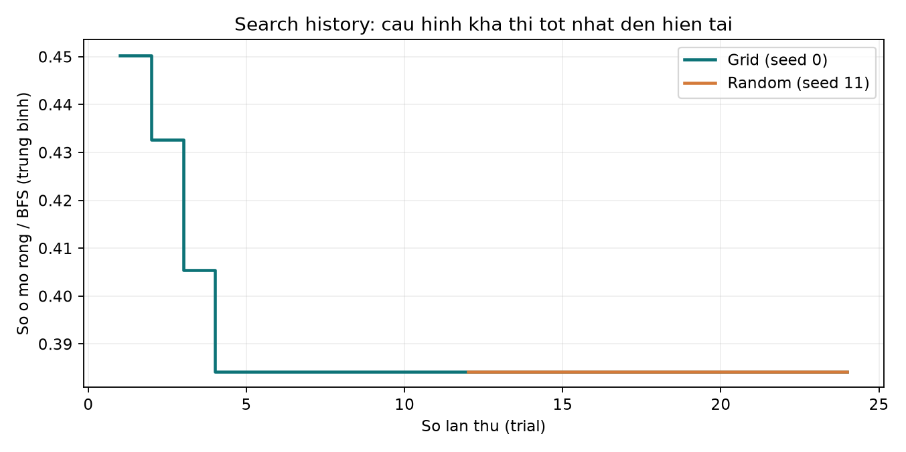

# Tối ưu hóa đường đi trong mê cung bằng thuật toán A* và phân tích đa mục tiêu

**Đồ án cá nhân - Nhập môn tối ưu hóa, Trường Đại học Văn Lang**  
**Sinh viên:** Dương Quốc Trọng | **MSSV:** 2274802010932  
**Giảng viên:** Nguyễn Thị Diễm Anh | **Mã LHP:** 261_71ITAI51403_0102

## 1. Problem - Đồ án giải quyết bài toán gì?

Một mê cung có những ô tường (1) và ô đi được (0), điểm bắt đầu S và đích G. Chương trình tìm đường từ S đến G, không đi xuyên tường, chỉ đi bốn hướng. Bài toán chính là **tìm đường có số bước ít nhất**. Ngoài ra, đồ án xem xét khả năng giảm số ô thuật toán phải mở rộng khi chấp nhận một mức tăng độ dài được kiểm soát.

Đây là **bài toán tìm đường (Routing / combinatorial optimization)**, không phải một mô hình Machine Learning dự đoán. Phần Grid Search / Random Search và Pareto được áp dụng theo nguyên lý thực nghiệm của Chương 6, không yêu cầu huấn luyện mạng nơ-ron.

## 2. Optimization Formulation - Mô hình hóa

- **Biến quyết định:** `p=(v0,...,vk)` là dãy ô trên đường từ S đến G. Với bài toán chọn chiến lược tìm kiếm, `w` là hệ số heuristic của Weighted A*.
- **Hàm mục tiêu chính:** `min L(p)=k`, tức số bước đi.
- **Ràng buộc:** `v0=S`, `vk=G`, mỗi ô là ô trống; hai ô liên tiếp kề nhau theo bốn hướng; không đi ra ngoài mê cung.
- **Tối ưu thứ cấp có đánh đổi:** giảm số ô mở rộng `E(w)` với `L_w(m)/L*(m) <= 1.15` trên *từng mê cung development*; `L*` do BFS xác định. Pareto: đồng thời giảm trung bình `L_w/L*` và `E(w)`.
- **Giả định:** mỗi bước có chi phí 1; tường không thể đi qua; mê cung hữu hạn và luôn có lối tới đích.

## 3. Dataset - Dữ liệu

- 48 mê cung sinh bằng thuật toán DFS carving rồi mở thêm một số tường nối để tạo nhiều ngả; các kích cỡ **21×21** và **31×31**, xác suất mở thêm các vòng **0.08 / 0.14 / 0.20** theo mã mẫu.
- Seed dataset cố định **2026**; mỗi bản đồ lưu toàn bộ lưới/seed vào `data/mazes.json`.
- Chia một lần: **36 development (M01-M36)** để chọn `w`, **12 test (M37-M48)** chỉ đánh giá sau khi đã chốt cấu hình.
- Dữ liệu **tự sinh (synthetic)**, có công thức và mã sinh; không lấy từ doanh nghiệp hay tập benchmark công khai, do đó **không yêu cầu điểm cộng dữ liệu**.
- Preprocessing: không cần scale/fit; chỉ xác định tọa độ S=(1,1), G=(n-2,n-2) và giữ lưới 0/1.

## 4. Method - Phương pháp

- **BFS (baseline):** duyệt theo từng lớp bước, trả đường ngắn nhất khi mỗi bước có trọng số bằng nhau.
- **Dijkstra (kiểm chứng độc lập):** giải shortest path với chi phí bước 1; đối chiếu nghiệm BFS.
- **A* (phương pháp tối ưu chính):** `f(n)=g(n)+h(n)`, `h=|y-yG|+|x-xG|` (Manhattan). Vì heuristic không đánh giá quá mức khoảng cách thật nên A* với `w=1` bảo đảm tìm đường ngắn nhất.
- **Weighted A*:** `f(n)=g(n)+w*h(n)` với `w>=1`. Các giá trị lớn có thể mở rộng ít ô hơn nhưng **không bảo đảm luôn trả về đường ngắn nhất**.
- **Grid Search:** 24 trọng số từ 1.0 đến 3.3, mỗi bước 0.1.
- **Random Search:** 24 trọng số khác nhau được chọn trong {1.00, 1.05, ..., 3.30}; so sánh chính dùng seed **11**, các seed **22,33,44** dùng để đánh giá độ ổn định, không tăng ngân sách so sánh chính.
- **Quy tắc chọn:** chỉ chấp nhận cấu hình có `max(L/L*) <=1.15` trên development; trong các cấu hình này chọn số ô mở rộng/BFS trung bình nhỏ nhất. Cấu hình được khóa **trước khi** đánh giá test.
- **Budget:** mỗi lượt tìm kiếm có 24 evaluations; mỗi evaluation chạy trên cùng 36 mê cung. Thời gian chạy ghi trong CSV, thay đổi theo phần cứng.

## 5. Key Results - Số liệu chạy thực tế

| Phương pháp (test, 12 mê cung) | Bước TB | Số ô mở rộng TB | Hệ số dài đường TB | Tỷ lệ đúng ngắn nhất |
|---|---:|---:|---:|---:|
| BFS | 51.833 | 325.667 | 1.00000 | 100% |
| A* (w=1) | 51.833 | 115.667 | 1.00000 | 100% |
| Weighted A* (w=1.3) | 52.000 | 96.500 | 1.00298 | 91.67% |

- Grid và Random (seed 11) đều chọn **w=1.3** trên development; trung bình số ô mở rộng bằng **0.3842 lần BFS**, hệ số dài đường trung bình **1.0130**, tệ nhất **1.1111** trên development.
- Trên test, Weighted A* đi dài hơn đường ngắn nhất **2 bước ở M48** (58 so với 56), các mê cung còn lại bằng tối ưu. Không được gọi Weighted A* là thuật toán luôn tìm đường ngắn nhất.
- Random Search 4 seed: tỷ số số ô mở rộng/BFS của cấu hình tốt nhất có **mean=0.3848, std=0.0144** trên development.
- **Quyết định:** Nếu bắt buộc đường ngắn nhất, chọn A* (w=1). Nếu chấp nhận đường dài hơn tối đa 15% trong phạm vi thử nghiệm và muốn giảm số ô duyệt, cân nhắc w=1.3. Giới hạn 15% được xác minh trên các mê cung mẫu, không phải bảo đảm cho mọi mê cung bất kỳ.





## 6. How to Run - Cách chạy

**Windows (Python 3.10 trở lên):**

1. Giải nén thư mục dự án.
2. Nhấp đôi `setup_windows.bat` (tạo `.venv`, cài `matplotlib`).
3. Nhấp đôi `run_windows.bat` (chạy 10 bài kiểm tra và thí nghiệm từ đầu).
4. Xem `results/summary.json`, `results/trial_history.csv`, `results/test_results.csv`, `figures/`.

**Chạy thủ công trong PowerShell (ở thư mục gốc dự án):**

```powershell
py -3 -m venv .venv
.\.venv\Scripts\Activate.ps1
python -m pip install -r requirements.txt
python -m unittest discover -s tests -v
python run_project.py
```

Có thể mở `notebooks/maze_shortest_path.ipynb` bằng Jupyter hoặc VS Code để xem từng bước. Notebook có minh họa và đọc kết quả đã được code sinh ra.

## 7. Repository Structure - Cấu trúc

```text
maze-shortest-path-optimization/
├── README.md
├── requirements.txt
├── .gitignore
├── run_project.py
├── setup_windows.bat
├── run_windows.bat
├── data/mazes.json
├── src/maze.py, algorithms.py, experiment.py
├── tests/test_maze.py
├── notebooks/maze_shortest_path.ipynb
├── results/trial_history.csv, pareto_candidates.csv,
│   test_results.csv, random_stability.csv, summary.json
├── figures/01_maze_paths.png, 02_search_history.png,
│   03_pareto.png, 04_sensitivity.png
└── report/Bao_cao_Toi_uu_hoa_duong_di_me_cung_Astar_Duong_Quoc_Trong.docx
    report/Tom_tat_bao_ve_1_trang.pdf
```

## 8. Limitations - Hạn chế

- Mê cung tự tạo, chưa đại diện cho đường sá thật; mỗi bước cùng chi phí.
- Thời gian được đo trên môi trường thực thi tại thời điểm chạy, phụ thuộc hệ điều hành/phần cứng; nên phân tích thêm số ô mở rộng.
- Weighted A* có thể không tìm được đường ngắn nhất và tỷ lệ độ dài vượt giới hạn trên mê cung chưa quan sát.
- Không gian tuning một tham số, phù hợp phạm vi học phần; không suy rộng kết quả sang thuật toán hoặc bản đồ khác.

## 9. GitHub Portfolio / tiến độ 5 tuần

Đề bài yêu cầu **repository public và ít nhất 5 commit có ý nghĩa theo tiến độ 5 tuần**. Bộ ZIP không tự tạo lịch sử Git và **chưa được xuất bản lên GitHub**. Khi làm/nộp thật, sinh viên cần giữ các commit/checkpoint trung thực: (1) mô hình hóa và README, (2) dataset/BFS, (3) A* và tìm kiếm, (4) thực nghiệm/biểu đồ, (5) báo cáo và kết luận. Không tạo ngày commit giả hoặc giả vờ có lịch sử 5 tuần.

**Tên repo gợi ý:** `maze-shortest-path-optimization`. **Topics:** `optimization`, `pathfinding`, `astar`, `bfs`, `pareto`, `python`.

**Đường dẫn GitHub mới:** chưa có; cập nhật đường dẫn thật vào phần phụ lục báo cáo và LMS sau khi đã tạo repo công khai. Không dùng link repo Random Forest cũ cho đề tài này. Có thể tạo tag `v1.0` sau khi hoàn tất.

## 10. AI assistance - Công cụ hỗ trợ

Có sử dụng ChatGPT để hỗ trợ xây dựng cấu trúc mã, mô tả thuật toán và trình bày báo cáo. Tính đúng của nghiệm được kiểm tra bằng BFS, Dijkstra và 10 bài kiểm tra tự động; bảng/hình được xuất trực tiếp từ chương trình. Sinh viên có trách nhiệm tự chạy, đọc và giải thích mã trước khi nộp.
