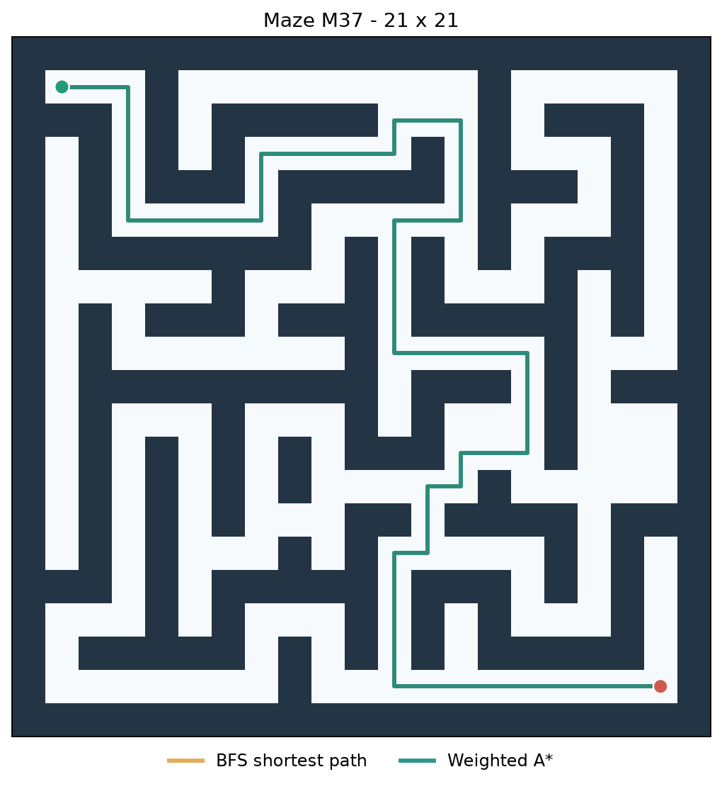
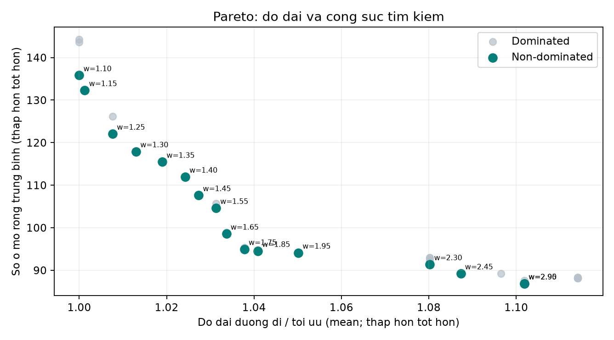
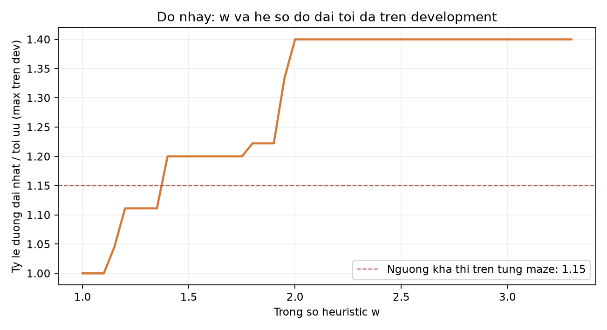

# TỐI ƯU HÓA ĐƯỜNG ĐI TRONG MÊ CUNG BẰNG THUẬT TOÁN A* VÀ PHÂN TÍCH ĐA MỤC TIÊU

**Trường:** Đại học Văn Lang  
**Khoa:** Công nghệ thông tin  
**Môn học:** Nhập môn tối ưu hóa  
**Sinh viên:** Dương Quốc Trọng  
**Mã số sinh viên:** 2274802010932  
**Giảng viên:** Nguyễn Thị Diễm Anh  
**Mã lớp học phần:** 261_71ITAI51403_0102

## 1. Problem – Giới thiệu bài toán

### 1.1. Nội dung đồ án

Đồ án nghiên cứu cách tìm đường đi từ điểm bắt đầu **S** đến đích **G** trong một mê cung. Mê cung được biểu diễn bằng lưới hai chiều: `0` là ô có thể đi qua, `1` là ô tường. Người đi chỉ di chuyển theo bốn hướng: lên, xuống, trái, phải.

Mục tiêu chính là **tìm đường có số bước ít nhất**, không đi xuyên tường hoặc ra ngoài bản đồ. Ngoài ra, đồ án xem xét khả năng **giảm số ô thuật toán cần mở rộng** trong quá trình tìm kiếm, với một mức tăng độ dài đường đi được kiểm soát.

### 1.2. Phạm vi

Đây là **bài toán tối ưu tìm đường (Routing / tối ưu tổ hợp)**, không phải mô hình Machine Learning dự đoán. Đồ án vận dụng tìm kiếm tham số và phân tích đa mục tiêu theo nội dung Chương 6 của học phần.

## 2. Optimization Formulation – Mô hình hóa bài toán

### 2.1. Biến quyết định và hàm mục tiêu

Đường đi là dãy `p = (v0, v1, ..., vk)`, trong đó `v0 = S`, `vk = G` và `k` là số bước. Hàm mục tiêu chính:

`min L(p) = k`

Khi xem xét chiến lược tìm kiếm Weighted A*, biến điều chỉnh là **trọng số heuristic `w ≥ 1`**. Mục tiêu thứ cấp là giảm số ô được mở rộng `E(w)`.

### 2.2. Ràng buộc và giả định

- Mỗi ô của đường đi phải là ô trống (`0`) và nằm trong mê cung.
- Hai ô liên tiếp phải kề nhau theo một trong bốn hướng.
- Đường đi bắt đầu tại `S`, kết thúc tại `G`.
- Mỗi bước có chi phí bằng `1`; mê cung hữu hạn và có đường tới đích.

Trong bước chọn trọng số trên tập **development**, chương trình chỉ chấp nhận các cấu hình thỏa mãn ràng buộc trên **từng mê cung**:

`Lw(m) / L*(m) ≤ 1.15`

Trong đó `Lw(m)` là độ dài đường của Weighted A*, còn `L*(m)` là đường ngắn nhất tính bằng BFS. Phân tích Pareto xem xét đồng thời tỷ số độ dài `Lw/L*` và số ô mở rộng `E(w)`.

## 3. Dataset – Dữ liệu thực nghiệm

- **48 mê cung tự sinh (synthetic)** bằng DFS carving; một số tường được mở thêm để tạo nhiều đường lựa chọn.
- Hai kích thước: **21×21** và **31×31**; tỷ lệ mở thêm đường theo thiết lập: **0.08 / 0.14 / 0.20**.
- **Seed tạo dữ liệu: `2026`**. Lưới mê cung và thông tin tái lập được lưu trong `data/mazes.json`.
- **36 mê cung development (M01–M36):** dùng tìm kiếm/chọn trọng số.
- **12 mê cung test (M37–M48):** dùng báo cáo kết quả đánh giá sau khi chốt trọng số.
- Không cần chuẩn hóa đặc trưng; điểm đầu `S=(1,1)`, điểm cuối `G=(n-2,n-2)`.

Dữ liệu do chương trình tạo, không sử dụng thông tin cá nhân. Đây không phải benchmark được công bố nên không yêu cầu điểm cộng dữ liệu.

**Lưu ý về quy trình:** Mã có tính nghiệm BFS tham chiếu trên các mê cung. Tuy nhiên, việc tìm kiếm và chọn trọng số chỉ dựa trên **36 mê cung development**, không dùng điểm số test để lựa chọn tham số. Bảng đánh giá cuối được lập sau khi cố định trọng số.

## 4. Method – Phương pháp thực hiện

### 4.1. Thuật toán tìm đường

- **BFS (Baseline):** mở rộng các ô theo từng lớp khoảng cách; bảo đảm đường ngắn nhất khi chi phí mỗi bước bằng nhau.
- **Dijkstra (kiểm chứng độc lập):** tìm đường có tổng chi phí nhỏ nhất khi chi phí bước không âm; được dùng đối chiếu kết quả trong trường hợp chi phí mỗi bước bằng `1`.
- **A*:** chọn ô theo `f(n) = g(n) + h(n)`, với `h(n)` là khoảng cách Manhattan: `|y-yG| + |x-xG|`. Heuristic này không vượt quá chi phí thật trong mê cung bốn hướng, nên A* chuẩn (`w=1`) bảo đảm đường ngắn nhất.
- **Weighted A*:** dùng `f(n) = g(n) + w×h(n)` với `w ≥ 1`. Trọng số lớn có thể giúp giảm số ô mở rộng, nhưng **không bảo đảm đường ngắn nhất**.

### 4.2. Tìm kiếm trọng số

- **Grid Search:** thử **24 trọng số** từ `1.0` đến `3.3` với bước `0.1`.
- **Random Search:** chọn **24 trọng số khác nhau** từ tập `{1.00, 1.05, ..., 3.30}`. Lượt so sánh chính dùng seed `11`; các seed `22`, `33`, `44` dùng để khảo sát độ ổn định.
- **Ngân sách:** mỗi phương pháp có 24 lượt đánh giá trong phép so sánh chính; mỗi lượt chạy trên cùng 36 mê cung development.

Cấu hình phải thỏa `max(Lw/L*) ≤ 1.15` trên development. Trong các cấu hình hợp lệ, chương trình chọn cấu hình có **tỷ số số ô mở rộng so với BFS trung bình nhỏ nhất**. Sau đó cố định trọng số trước khi tổng hợp kết quả trên test.

### 4.3. Phân tích Pareto

Phân tích sự đánh đổi giữa **độ dài đường đi** và **số ô mở rộng**. Một cấu hình là không bị trội (non-dominated) nếu không có cấu hình khác tốt hơn hoặc bằng ở cả hai mục tiêu và tốt hơn nghiêm ngặt ở ít nhất một mục tiêu.

## 5. Key Results – Kết quả thực nghiệm

### 5.1. Kết quả trên 12 mê cung test

| Thuật toán | Số bước TB | Số ô mở rộng TB | Hệ số dài đường TB | Tỷ lệ tìm đúng đường ngắn nhất |
|---|---:|---:|---:|---:|
| BFS | 51.833 | 325.667 | 1.00000 | 100% |
| A* (`w=1`) | 51.833 | 115.667 | 1.00000 | 100% |
| Weighted A* (`w=1.3`) | 52.000 | 96.500 | 1.00298 | 91.67% |

BFS và A* đều tìm đúng đường ngắn nhất ở **12/12** mê cung. Weighted A* tìm đường tối ưu ở **11/12** mê cung; tại **M48**, đường đi dài **58 bước** so với **56 bước** tối ưu.

### 5.2. Kết quả chọn trọng số trên development

- Grid Search và Random Search (seed `11`) đều tìm được **`w=1.3`**.
- Tỷ số số ô mở rộng trung bình so với BFS: **`0.3842`**.
- Hệ số độ dài đường trung bình: **`1.0130`**.
- Hệ số độ dài đường lớn nhất trong development: **`1.1111`**.
- Random Search qua 4 seed: tỷ số số ô mở rộng/BFS của cấu hình tốt nhất có **mean `0.3848`, std `0.0144`**.

**Quyết định:** Nếu bắt buộc tìm đường ngắn nhất, chọn **A* chuẩn (`w=1`)**. Nếu muốn giảm công sức tìm kiếm và chấp nhận đường dài hơn một chút, có thể cân nhắc **Weighted A* (`w=1.3`)**. Giới hạn tăng độ dài 15% là ràng buộc được kiểm tra trên development, **không phải bảo đảm cho mọi mê cung mới**.

### 5.3. Hình minh họa

**Hình 1. Đường đi trong mê cung**



**Hình 2. Lịch sử tìm kiếm trọng số**


**Hình 3. Phân tích Pareto**



**Hình 4. Phân tích độ nhạy**



## 6. How to Run – Hướng dẫn chạy

**Môi trường:** Windows, Python **3.10 trở lên**, thư viện theo `requirements.txt`.

### Cách 1: Chạy bằng các file Windows

1. Tải hoặc giải nén thư mục dự án.
2. Chạy `setup_windows.bat` để tạo môi trường `.venv` và cài thư viện.
3. Chạy `run_windows.bat` để thực hiện 10 bài kiểm thử, sau đó chạy thí nghiệm.
4. Xem các kết quả trong `results/` và hình minh họa trong `figures/`.

### Cách 2: Chạy trong VS Code / PowerShell

Mở Terminal tại thư mục gốc dự án:

```powershell
py -3 -m venv .venv
.\.venv\Scripts\python.exe -m pip install -r requirements.txt
.\.venv\Scripts\python.exe -m unittest discover -s tests -v
.\.venv\Scripts\python.exe run_project.py
```

Các file kết quả chính:

- `results/summary.json`: Tổng hợp kết quả.
- `results/trial_history.csv`: Lịch sử tìm kiếm tham số.
- `results/pareto_candidates.csv`: Các cấu hình dùng phân tích Pareto.
- `results/test_results.csv`: Kết quả test.
- `results/random_stability.csv`: Khảo sát độ ổn định.

Có thể mở `notebooks/maze_shortest_path.ipynb` bằng VS Code hoặc Jupyter để xem cách triển khai và kết quả theo từng bước.

## 7. Repository Structure – Cấu trúc dự án

```text
toi-uu-hoa-duong-di-me-cung/
├── README.md
├── requirements.txt
├── .gitignore
├── run_project.py
├── setup_windows.bat
├── run_windows.bat
├── data/
│   ├── README.md
│   └── mazes.json
├── src/
│   ├── __init__.py
│   ├── maze.py
│   ├── algorithms.py
│   └── experiment.py
├── tests/
│   └── test_maze.py
├── notebooks/
│   └── maze_shortest_path.ipynb
├── results/
│   ├── trial_history.csv
│   ├── pareto_candidates.csv
│   ├── test_results.csv
│   ├── random_stability.csv
│   └── summary.json
├── figures/
│   ├── 01_maze_paths.png
│   ├── 02_search_history.png
│   ├── 03_pareto.png
│   └── 04_sensitivity.png
└── report/
    ├── Bao_cao_do_an.docx
    └── Tom_tat_do_an.docx
```

Hai tên file trong `report/` ở trên là tên hiện sử dụng trên GitHub. File `.gitignore` cần được giữ trong repository để loại trừ file môi trường, cache và tệp tạm.

## 8. Limitations – Hạn chế

- Dữ liệu mê cung tự sinh, chưa đại diện cho mạng đường sá thực tế.
- Chỉ xét bốn hướng di chuyển và mỗi bước có chi phí bằng nhau.
- Thời gian chạy thay đổi theo phần cứng, hệ điều hành và điều kiện chạy; nên xem thêm số ô mở rộng.
- Weighted A* có thể trả về đường dài hơn ngắn nhất, kể cả vượt giới hạn cho phép trên mê cung chưa quan sát.
- Việc tinh chỉnh chỉ xét một trọng số, phù hợp phạm vi bài tập lớn cá nhân. Kết quả không suy rộng cho mọi mê cung và mọi thuật toán.

## 9. GitHub Portfolio và tiến độ 5 tuần

### 9.1. Thông tin kho lưu trữ

Đồ án đã được tải lên GitHub công khai để lưu mã nguồn, kết quả thực nghiệm và tài liệu phục vụ kiểm tra, tái lập.

- **Tên repository:** `toi-uu-hoa-duong-di-me-cung`
- **Tài khoản GitHub:** `quoctrong2004`
- **Trạng thái:** Public (Công khai)
- **Đường dẫn:** https://github.com/quoctrong2004/toi-uu-hoa-duong-di-me-cung

### 9.2. Các giai đoạn thực hiện theo yêu cầu học phần

| Tuần | Nội dung công việc |
|---|---|
| 1 | Chọn đề tài, mô hình hóa bài toán, xác định mục tiêu/ràng buộc và chuẩn bị README. |
| 2 | Sinh dữ liệu mê cung, cài đặt BFS và kiểm tra đường đi. |
| 3 | Cài đặt A*, Weighted A*, Grid Search và Random Search. |
| 4 | Chạy thực nghiệm, lưu lịch sử/kết quả, phân tích Pareto và tạo biểu đồ. |
| 5 | Hoàn thiện kiểm thử, báo cáo, tài liệu bảo vệ và GitHub Portfolio. |

Đây là **các giai đoạn theo kế hoạch học phần**, không tự động chứng minh lịch sử làm việc thực tế. Đề bài yêu cầu tối thiểu **5 commit có ý nghĩa theo tiến độ 5 tuần**. Lịch sử commit cần phản ánh đúng những lần chỉnh sửa, kiểm thử và hoàn thiện thật; không tạo lịch sử hoặc ngày commit giả.

### 9.3. Hoàn thiện bản nộp

- Bảo đảm repository ở chế độ Public và các tệp có thể truy cập.
- Giữ mã nguồn, dữ liệu, kết quả, biểu đồ và báo cáo nhất quán.
- Đưa đường dẫn GitHub vào báo cáo Word và nộp trên LMS.
- Sau khi hoàn tất có thể tạo GitHub Release/tag `v1.0`.

## 10. AI Assistance – Công cụ hỗ trợ

Có sử dụng ChatGPT để hỗ trợ tổ chức mã nguồn, giải thích thuật toán và trình bày tài liệu. Quy trình kiểm chứng bao gồm đối chiếu nghiệm BFS/Dijkstra/A*, kiểm tra tính hợp lệ của đường đi và chạy **10 bài kiểm thử tự động**; bảng và hình được xuất từ chương trình.

Sinh viên chịu trách nhiệm tự chạy lại trên máy của mình, kiểm tra số liệu và có thể giải thích nguyên lý, mã nguồn và kết quả khi bảo vệ.
